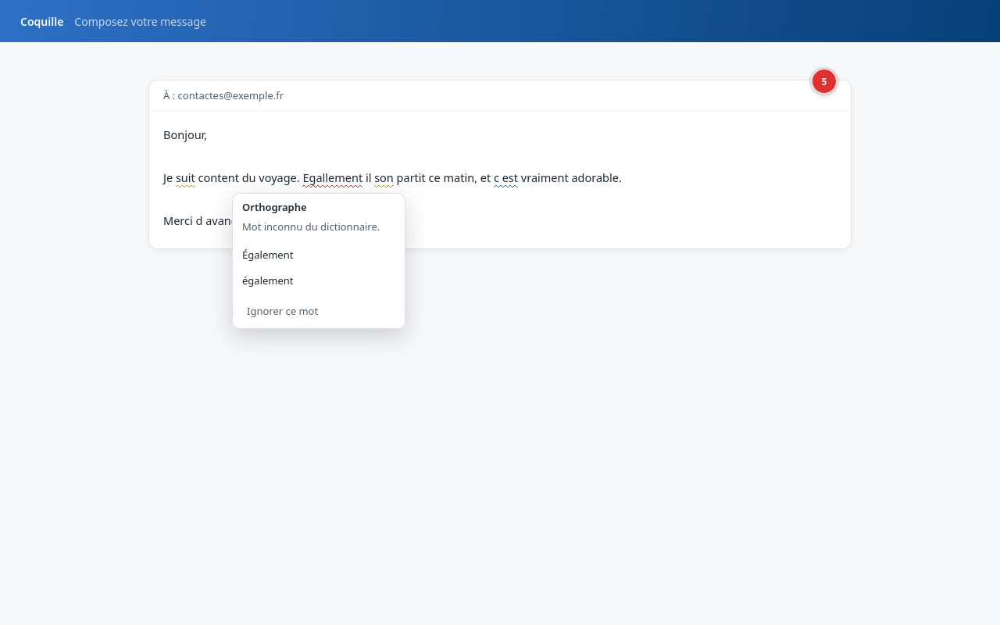
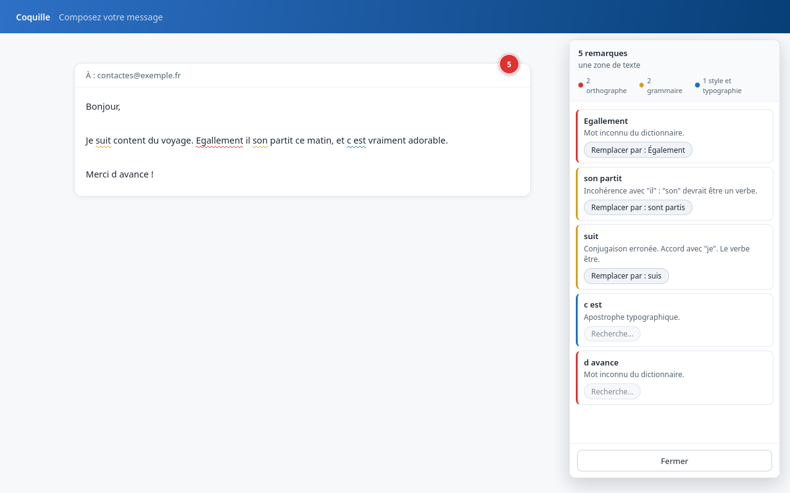

# Coquille

Firefox and Chrome extension providing in-place French spelling and grammar
checking, powered by the [Grammalecte](https://grammalecte.net/) engine.

- Repository: <https://github.com/PaulExplorer/Coquille>
- Bug reports and suggestions: the repo's GitHub Issues

The original Grammalecte web extension analyses the page text inside a side
panel and writes corrections back paragraph by paragraph. This project keeps
the upstream engine (rules, spell checker, dictionaries) untouched and
replaces the interface: detected text fields are underlined directly on the
page, and corrections are applied inline through the browser editing
pipeline.

## Features

- Inline underlines by category (red for spelling, yellow for grammar, blue
  for style and typography) in `textarea`, single-line inputs and
  contenteditable hosts, following the focused field.
- Summary circle on the field: green check or red error count, opens the
  review panel.
- Optional suppression of the browser's own spellcheck on analyzed fields,
  so the red squiggles of the browser and the underlines of Coquille do not
  pile up (on by default, settings page).
- Honors a page's `spellcheck="false"` declaration (skips fields where the
  site turned checking off), with an override in the settings page.
- Suggestion popover on click: replace, ignore a word or a rule.
- Per-site disable switch (popup or options), applied per domain and its
  subdomains.
- Engine rule toggles taken from the engine's own option labels.
- Personal list of ignored words and rules.
- Everything runs locally in the extension; no text is sent anywhere.

## Screenshots





## Installation

No signed package is published yet; builds come from tagged GitHub releases
(`coquille-firefox.zip`, `coquille-chrome.zip`).

Chrome, Edge, Brave and other Chromium browsers:

1. Download and unzip `coquille-chrome.zip`.
2. Open `chrome://extensions`, enable **Developer mode** (top-right toggle).
3. Click **Load unpacked** and select the unzipped folder.

Firefox, temporary install (until you close Firefox, handy for a try):

1. Download `coquille-firefox.zip` and rename it to `coquille.xpi`.
2. Open `about:debugging`, click **This Firefox**, then **Load Temporary
   Add-on** and pick the `.xpi` file.

Firefox, permanent install without a store listing: unsigned extensions
only load in Firefox Developer Edition or Nightly.

1. Open `about:config`, set `xpinstall.signatures.required` to `false`.
2. Open `about:addons`, cog icon, **Install Add-on From File...**, pick the
   `.xpi`.

Everyday Firefox installs get the signed package from
[addons.mozilla.org](https://addons.mozilla.org/) once the listing is
approved.

## Building

See [BUILD.md](BUILD.md) for full details, privacy policy in
[PRIVACY.md](PRIVACY.md).

```sh
npm install
npm run build:firefox   # .output/firefox-mv3
npm run build           # .output/chrome-mv3
npm run zip:firefox     # AMO web-ext zip
```

Firefox development: `npm run dev:firefox`. Chrome development: `npm run dev`.

## Updating the engine

The engine is vendored as build output from the Grammalecte source tree and
is never edited in this repository. To update it:

1. Obtain an up-to-date Grammalecte source tree yourself (an archive or a git
   checkout of a mirror). No script here fetches anything over the network.
2. Package it:

   ```sh
   python3 scripts/update_engine.py --from /path/to/grammalecte
   ```

   The script runs `make.py fr -js` in that tree, copies the JavaScript and
   the runtime data files into `src/engine/grammalecte/` and
   `public/grammalecte/`, generates the joined bundle used by the
   background, and records the engine version and source path in
   `public/grammalecte/ENGINE_VERSION.json`.
3. Review the diff and commit.

## Code map

- `src/engine/grammalecte/`: vendored engine (verbatim files plus a
  generated bundle and stub modules for upstream's CommonJS fallbacks, which
  are dead code in a browser).
- `src/engine/glue/`: engine initialization replicating upstream's
  `gce_worker.js` steps (async data loading for MV3) and the raw-offset
  mapping between page text and the engine's normalized text.
- `src/content/`: field detection, mirror-based measurement, underline
  rendering in a shadow layer, suggestion popover and text replacement.
- `src/entrypoints/`: background (engine host and request router), content
  script, popup, options page.
- `src/lib/`: typed message contract, settings storage, site normalization.

## Releases

GitHub Actions build both targets on every push and attach the Firefox zip
(AMO-ready, `web-ext`) and the Chrome zip to tagged releases
(`.github/workflows/release.yml`).

## Limitations

- French only, by design: the interface and the engine are French-only and
  the extension will stay that way.
- Rich editors are covered through the contenteditable path; exotic editors
  (Google Docs canvas) are not supported.
- Text fields inside iframes are reached too (the content script runs in
  every frame); the popup badge and the review panel reflect the focused
  frame's session.
- Engine rule and option wording comes from the engine build.

## Licences and credits

Engine and rules: [Grammalecte](https://grammalecte.net/) by Olivier R.,
licensed GPL-3.0-or-later. This project therefore distributes its own code
under GPL-3.0-or-later (see `LICENSE` and `THIRD_PARTY_NOTICES.md`).

The in-flight rendering approach (field mirroring to locate text offsets,
rect clipping, popover positioning patterns) draws on the Harper grammar
checker's lint framework (Apache-2.0, © Automattic Inc.).

Third-party notices are listed in `THIRD_PARTY_NOTICES.md`; the options page
"À propos" tab carries the same credits.

---

This project was written with the assistance of an AI coding agent; the
resulting code was reviewed and maintained by human contributors.
